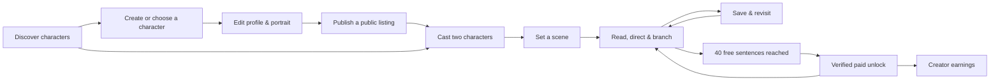
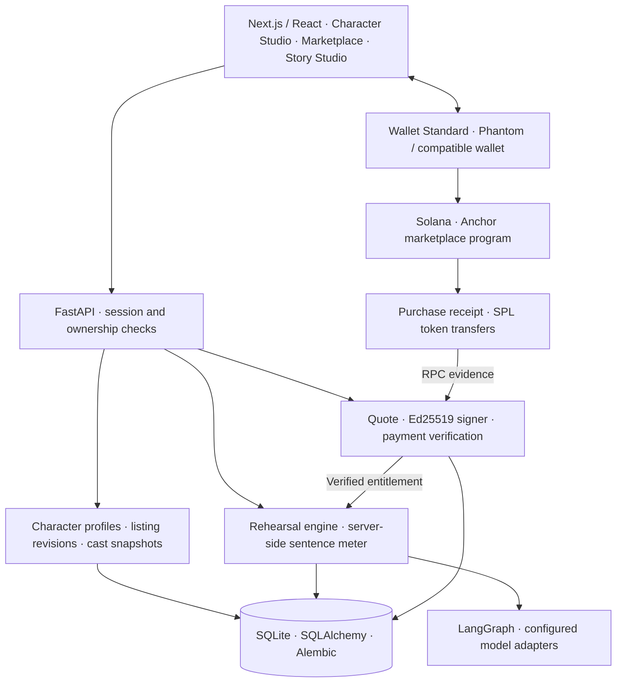
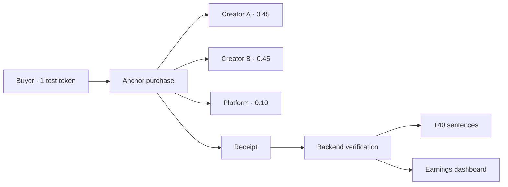

<div align="center">
  
  <h1>Echoloom</h1>
  <p><strong>Your favorite characters. Stories only you can direct.</strong></p>
  <p>A character marketplace and AI-powered story studio where you can create a character, share them with others, and bring two characters into a story of your own.</p>
  <p><a href="demo/Echoloom_Character_Marketplace_Demo.mp4"><strong>Watch the product demo</strong></a> · <a href="#quick-start"><strong>Get started</strong></a> · <a href="#architecture"><strong>Explore the architecture</strong></a></p>
  <p>
    <a href="https://github.com/Roxyh-code/Echoloom_marketplace/actions/workflows/ci.yml"></a>
    
    
    
    
    
  </p>
</div>

> **Project status:** Local hackathon prototype. Character creation, publishing, interactive rehearsal, wallet verification, creator payout setup, signed checkout, receipt verification and earnings reporting are implemented in code. Standard CI passed for the integration and demo PRs; full local-validator execution and live Devnet payment acceptance remain unverified. Payments are disabled by default. The banner is illustrative, not an app screenshot.

---

## The idea

Stories do not have to end where their authors left them.

What if two characters from different worlds met? What if a favorite character chose another path? What if you could decide how their next conversation unfolds rather than simply reading it?

**Echoloom turns characters into the starting point of collaborative storytelling.** Creators build original or properly licensed characters, readers discover and cast them, and an AI-powered rehearsal engine develops the scene as the reader directs, revises and branches the narrative.

Unlike a single-character chat interface, Echoloom is designed around **two-character scenes, creative direction and revisitable story versions**.

## Watch it in action

[**▶ Watch the recorded character-to-marketplace walkthrough (MP4)**](demo/Echoloom_Character_Marketplace_Demo.mp4)

The video shows the running app's character creation, profile editing, publishing, listing updates and entry into a two-character scene. It was recorded using deterministic AI demo fixtures and the real frontend/API workflow, not a live paid-model session. See [demo/README.md](demo/README.md) for the recording scope.

### From character to story



### A glimpse of the character shelf

<table>
  <tr>
    <td align="center"></td>
    <td align="center"></td>
    <td align="center"></td>
    <td align="center"></td>
  </tr>
  <tr>
    <td align="center"><b>Mira</b></td>
    <td align="center"><b>Leo</b></td>
    <td align="center"><b>Vesper</b></td>
    <td align="center"><b>Ren</b></td>
  </tr>
</table>

<p><small>These are existing <strong>development-only placeholder illustrations</strong>, not evidence of public listing ownership or commercially cleared art. Some preview cards cannot be cast. Original licenses have not been verified; see <a href="docs/SAMPLE_ART_ASSETS.md">sample-art provenance and restrictions</a>.</small></p>

## What you can build today

| Experience | Current implementation |
| --- | --- |
| **Discover** | Browse published characters, search and filter the character catalog, and open public or private character details. |
| **Character Studio** | Create an AI-assisted character profile, generate a portrait, edit/refine the profile and manage portrait versions. The profile can appear while the initial portrait finishes asynchronously. |
| **Creator publishing** | Publish an owned character with a public profile and rights confirmation; edit listing details, retain listing revisions, or unpublish. |
| **Two-character casting** | Choose two private characters, two published characters or a mixed pair. The backend verifies access to each source and uses listing revisions for public casts. |
| **Interactive rehearsal** | Set a premise, cast and scene constraints; generate a scene, reveal the story in sentence-sized steps, give directions, revise, branch and review versions. |
| **My Stories** | Reopen drafts, inspect versions, save a result and export story text. |
| **Free preview** | 40 free AI-generated sentences per normal scene, enforced on the server. The original built-in sample demo is exempt. |
| **Wallet connection** | Devnet-compatible Wallet Standard connection, signed ownership verification and restoration of an existing verified binding. |
| **Creator earnings** | Account-level payout wallet setup, per-listing monetization opt-in, zero-income listings and verified-payment reporting. |
| **Paid unlock** | Signed quote, client transaction builder, Anchor settlement, server-side receipt verification and 40 additional sentences per verified purchase. Live chain acceptance pending. |

The project uses a consistent, mobile-first **dark fantasy / moonlit violet** interface. Discover, Characters and My Stories share the same app frame and bottom navigation.

## Architecture

Echoloom separates creative orchestration from financial settlement. FastAPI is authoritative for scene access, pricing and attribution; the Solana program settles signed purchase terms and creates a durable receipt.



| Layer | Stack |
| --- | --- |
| Web app | Next.js 16, React 19, TypeScript, CSS |
| API / validation | Python 3.12+, FastAPI, Pydantic |
| Narrative orchestration | LangGraph 1.2.20, configurable text/image adapters |
| Persistence | SQLAlchemy, SQLite, Alembic |
| Wallet / blockchain | Wallet Standard, @solana/web3.js 1.98.4, Solana classic SPL Token |
| Smart contract | Rust, Anchor 1.1.2 |
| Authorization | Ed25519, cryptography, solders |
| Testing | Pytest, Playwright, GitHub Actions, local validator suite |

See the [architecture and API guide](docs/ARCHITECTURE.md) for module boundaries, payment sequence and trust assumptions.

**Implementation note:** Portrait generation currently uses in-process background work appropriate for a single-worker demo; it is **not** a production-grade distributed task queue.

## Quick start

### Requirements

- **Python 3.12+** and **Node.js 22** (recommended for Next.js 16)
- npm
- A local terminal; provider credentials only if you want to generate new AI content

**1. Clone and set up the backend** (macOS / Linux):

```bash
git clone https://github.com/Roxyh-code/Echoloom_marketplace.git
cd Echoloom_marketplace
python -m venv .venv
source .venv/bin/activate
python -m pip install -e ".[dev]"
cp .env.example .env
python -m alembic upgrade head
python -m uvicorn echoloom.api:app --host 127.0.0.1 --port 8000 --reload
```

**Windows PowerShell** alternative, from the cloned repository root:

```powershell
py -3.12 -m venv .venv
.\.venv\Scripts\python.exe -m pip install -e ".[dev]"
Copy-Item .env.example .env
.\.venv\Scripts\python.exe -m alembic upgrade head
.\.venv\Scripts\python.exe -m uvicorn echoloom.api:app --host 127.0.0.1 --port 8000 --reload
```

**2. Start the frontend** in a second terminal:

```bash
cd web
npm ci
npm run dev
```

**3. Open [http://127.0.0.1:3000/marketplace](http://127.0.0.1:3000/marketplace).**

Browse the characters, open **Characters** to create a profile, or visit **My Stories** for the prepared railway-station demo. You can explore that prepared demo **without model API keys**. Generating your own profiles, portraits or scenes requires configured providers.

### Optional: enable real AI generation

Copy [.env.example](.env.example) to a local `.env` (already ignored by Git). Provide model identifiers and API keys that your account can access:

```dotenv
LLM_PROVIDER=openai
LLM_MODEL=your-supported-text-model
LLM_API_KEY=your-private-key
IMAGE_PROVIDER=openai
IMAGE_MODEL=your-supported-image-model
IMAGE_API_KEY=your-private-key
```

The web app proxies `/api/*` to `http://127.0.0.1:8000` by default. Set `API_BASE_URL` in the frontend environment only if your API runs at another address. **Never commit API keys, database files or character/customer data.**

## Creator economy

Publishing is free. A creator must verify a payout wallet, satisfy creator approval requirements and opt in a listing before it becomes eligible for paid scenes. A buyer can use a different wallet from their payout wallet.

| Product rule | Implemented demo terms |
| --- | --- |
| Free allowance | 40 AI-generated sentences per normal scene |
| Paid unlock | +40 sentences on the same scene, no calendar expiry |
| Price | 1 test token (1,000,000 minor units; six decimals) |
| Creator A | 45% |
| Creator B | 45% |
| Platform | 10% |

Free usage creates no payout. If both cast slots have the same recipient wallet, the backend aggregates the two shares. Paid quotes require two eligible payout recipients (which may be the same wallet); the buyer cannot be a recipient. The token is a configured classic SPL test mint, not necessarily USDC. Network fees and token-account rent are separate from the pack price. This is a demo economic model, not a claim of profitable inference economics.



### Try creator onboarding without a deployed contract

For a disposable local demo only, set `SOLANA_CREATOR_SELF_SERVICE_ENABLED=true` and restart FastAPI. Open Characters → Publish → Set up earnings, verify the payout wallet, return to publishing, enable earnings and save. Leave the flag off for administrator-approved onboarding. Payment itself remains disabled until a verified Devnet configuration is available.

For three prepared accounts, two original listings and a 40-sentence checkout scene, follow the [isolated demo runbook](docs/DEMO_ENVIRONMENT.md). No wallet proofs or payments are fabricated.

### Enable Devnet checkout

Only after the program and config have been deployed and independently checked, configure the values in [.env.example](.env.example) using the [deployment checklist](docs/PAYMENT_DEPLOYMENT_CHECKLIST.md). The backend signer file must stay outside the repository. Keep `SOLANA_PAYMENTS_ENABLED=false` until readiness checks pass. Buyer and recipient wallets must use Devnet test assets, never real funds.

## Repository map

```text
Echoloom_marketplace/
├── web/
│   ├── app/                   # Next.js routes and styles
│   ├── components/            # Discover, Character Studio, Story Studio
│   └── e2e/                   # Playwright browser tests
├── src/echoloom/
│   ├── creator_*.py           # Character profiles and portraits
│   ├── marketplace_*.py       # Public listings and revisions
│   ├── rehearsal_*.py         # Scene engine and LangGraph workflow
│   ├── scene_access*.py       # Server-enforced reading allowance
│   └── payments/             # Wallets, quotes, receipts, entitlements, earnings
├── solana/                    # Anchor program, IDL and validator tests
├── scripts/                   # Local integration and demo preparation
├── tests/mvp/                 # Backend and integration tests
├── alembic/                   # Database migrations
├── demo/                      # Recorded product walkthrough
├── docs/                      # Architecture, provenance and contracts
└── .env.example               # Configuration template
```

## Testing

Backend regression tests:

```bash
python -m pytest -q tests/mvp
```

Frontend checks (inside `web/`):

```bash
npm run typecheck
npm run build
```

Playwright tests cover marketplace publishing, casting, character editing, story rehearsal, navigation and shared mobile-frame geometry. CI provisions a temporary Python test server, a Chromium browser and **fake AI providers**, so normal automated checks do not incur model usage fees. See [.github/workflows/ci.yml](.github/workflows/ci.yml) for the reproducible workflow.

## Validation and remaining work

| Workstream | Evidence / status |
| --- | --- |
| Character, marketplace and rehearsal flows | Implemented; browser and backend regression tests |
| Wallet persistence and creator onboarding | Implemented; PRs #49–51 merged with passing standard CI; local user testing reported |
| Payment integration safeguards | PR #52 merged; standard CI passed |
| Local validator and ledger acceptance | PR #53 merged; standard CI passed; full validator run not confirmed |
| Disposable demo environment | PR #54 merged; standard CI passed; actual operator run not confirmed |
| Devnet settlement and earnings | Deployment parameters and live end-to-end acceptance outstanding |
| Production readiness | Public authentication hardening, cross-device order reconciliation, concurrency safeguards, job queue, operations and licensing review outstanding |

Run payment regressions from the root:

```bash
python -m pytest -q tests/mvp -k payment
```

For real local-validator testing, install the Linux/WSL toolchain and follow [Local payment integration](docs/LOCAL_PAYMENT_INTEGRATION.md):

```bash
bash scripts/run-local-payment-e2e.sh
```

The standard CI workflow does not execute that full validator suite. The local bridge uses seeded order attribution and is not a complete browser/HTTP checkout test. The final demo must verify actual balance changes, receipt, 40→80→120 access, repeated verification and both creators' earnings. The [historical integration decision log](docs/HACKATHON_CONTRACT.md) includes superseded proposals; use this README and the current implementation guide for active behavior.

## Project background & responsible use

This repository was developed for **Dev3pack 2026** and builds on pre-existing character-creation and two-actor rehearsal work in [Echoloom V2](https://github.com/Roxyh-code/Echoloom_V2). The [migration record](docs/MIGRATION.md) documents what predates the hackathon and what was built or changed afterward.

**Local prototype only:** Authentication is not hardened for a public multi-user service. Use original characters or material you are licensed to distribute, and do not treat demo portraits as commercially reusable assets. The absence of a license file does not grant permission to redistribute third-party artwork or the repository's code.

For questions, bug reports and suggested contributions, open a [GitHub issue](https://github.com/Roxyh-code/Echoloom_marketplace/issues) or a pull request. For more technical detail, see [live-model acceptance](docs/LIVE_MODEL_ACCEPTANCE.md), [UI documentation](docs/EDITORIAL_UI.md) and the [product demo notes](demo/README.md).
