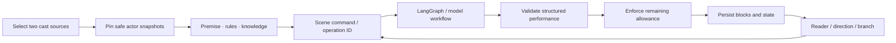
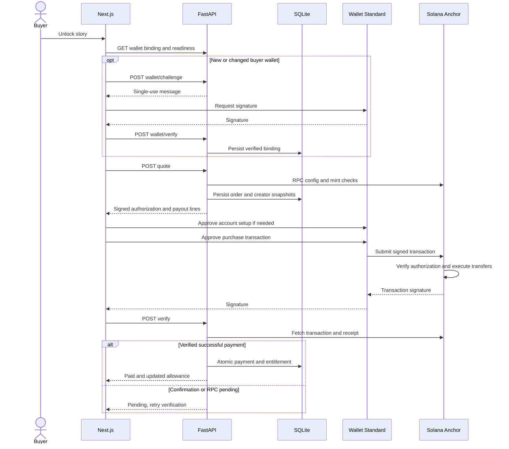
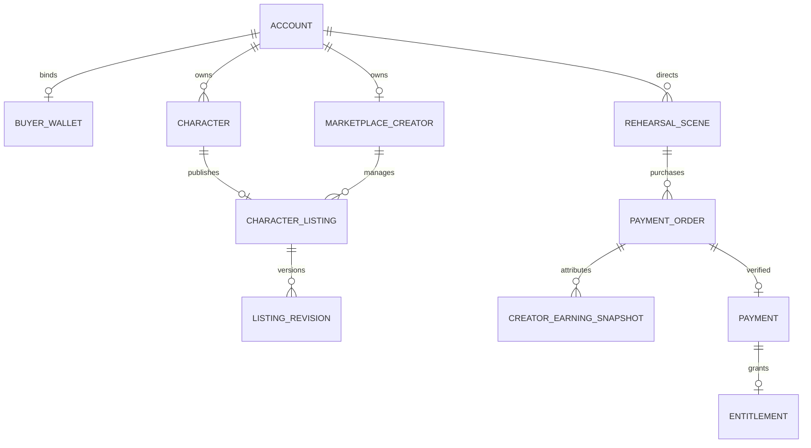

# Echoloom architecture and implementation guide

Status: hackathon prototype; application and settlement code integrated, live Devnet acceptance pending. This document describes the implemented interfaces, not a production SLA.

## 1. System boundaries

| Module | Responsibility |
| --- | --- |
| `web/app/`, `web/components/` | Mobile-first character, marketplace, rehearsal, publishing and earnings views; checkout and Wallet Standard integration |
| `src/echoloom/local_accounts.py` | Password-based account sessions and owner checks; wallet ownership is separate from login |
| `marketplace_service.py`, `marketplace_models.py` | Public allowlisted listing data, immutable revisions, approval and payout snapshots |
| `scene_casting.py` | Resolve private and public cast sources; pin current listing revision without exposing private profiles |
| `rehearsal_service.py`, `rehearsal_domain.py` | Scene commands, immutable history nodes, versions, generation and reading |
| `scene_access.py` | Enforce sentence allowance on generation, read and exported views |
| `payments/wallet.py`, `creator_onboarding.py` | Separate single-use buyer and creator payout signature challenges |
| `payments/quote.py`, `authorization.py`, `signer.py` | Resolve recipient eligibility, aggregate splits, persist order and attribution, sign fixed 462-byte terms |
| `payments/solana_rpc.py`, `readiness.py` | Validate Devnet configuration and scene eligibility |
| `payments/verification.py`, `receipt.py` | Verify transaction, finality, exact instructions/transfers and receipt |
| `payments/models.py`, `orders.py`, `earnings.py` | Payment and entitlement ledger, immutable creator allocation and owner-only reporting |
| `solana/programs/echoloom_marketplace/` | Rust/Anchor authorization verification, atomic SPL transfers, durable purchase receipt |

## 2. AI narrative workflow

The scene stores distinct actor knowledge, narrative blocks, sourced state and version history. The model receives the scene context and current user direction, not other users' private conversations. Branches preserve history and do not reset consumed allowance. Configurable providers supply generation; the optional memory experiments are not required for the demo. In-process workers are intended for a local single-worker prototype.

## 3. Payment sequence

The contract accepts generic signed payout terms, not a hardcoded 45/45/10 policy. FastAPI selects the product, price, split and recipients; the contract enforces signer, expiry, config version, account identity, conservation and one durable receipt per order. The buyer signs each actual transaction. The signer is an application authorization key, not a custodian of buyer funds.

## 4. Data and identity

Logical relationships shown; historical payment identifiers are intentionally not all foreign keys. A scene pins public listing revisions. Order attribution remains immutable even if a listing changes later. Payments are unique by order and transaction signature. Entitlements are scoped to the buyer account and scene; dashboards sum only verified paid orders. Different mints are not summed into a fictitious common currency.

## 5. Current HTTP interfaces

All payment endpoints require an authenticated local account. Public marketplace discovery is separate.

| Method | Route | Purpose |
| --- | --- | --- |
| GET | /api/payments/wallet | Saved buyer binding |
| POST | /api/payments/wallet/challenge | Buyer ownership challenge |
| POST | /api/payments/wallet/verify | Verify signature and bind |
| GET | /api/payments/creator/setup | Payout setup status |
| POST | /api/payments/creator/wallet/challenge | Payout-purpose challenge |
| POST | /api/payments/creator/wallet/verify | Verify payout ownership |
| POST | /api/marketplace/listings | Publish/edit; optional enable_earnings |
| GET | /api/marketplace/my-listings | Owner listing management |
| GET | /api/rehearsal/scenes/{id}/access | Server-authoritative allowance |
| GET | /api/payments/readiness/{scene_id} | Scene and deployment readiness |
| POST | /api/payments/quote | scene_id, buyer_wallet → signed order |
| POST | /api/payments/verify | order_id, tx_signature → pending/paid/rejected |
| GET | /api/payments/creator/earnings | Owner-only reporting |

See FastAPI schemas and route implementations for precise field validation.

## 6. Security boundaries and known limitations

- Default-off payment and demo self-service flags; Devnet only. No private wallet key is collected by the application.
- Signed buyer and payout challenges have distinct purposes, expiry and replay protection. Payout rotation is not yet supported.
- Verify server-side evidence before access is granted; never trust a browser paid flag.
- Default finalized commitment; confirmed is an explicit Devnet demo override.
- Recovery records are browser-local; cross-device discovery, cross-tab purchase coordination and ambiguous submission reconciliation remain limitations.
- Local account authentication, deployment operations and background workers require hardening before public use.
- Rights confirmation is not an independent licensing audit; development placeholder art is not cleared for commercial use.

## 7. Operational references

- [Creator onboarding](CREATOR_ONBOARDING.md)
- [Wallet restore](WALLET_RESTORE.md)
- [Deployment checklist](PAYMENT_DEPLOYMENT_CHECKLIST.md)
- [Local validator tests](LOCAL_PAYMENT_INTEGRATION.md)
- [Demo setup](DEMO_ENVIRONMENT.md)
- [Integration audit](PAYMENT_INTEGRATION_AUDIT.md)
- [Historical design contract](HACKATHON_CONTRACT.md): superseded pricing proposals are retained only for history.

The program source was integrated from the Solana teammate's workspace. Standard CI is distinct from live chain acceptance; no deployed program address or test transaction is asserted here.
